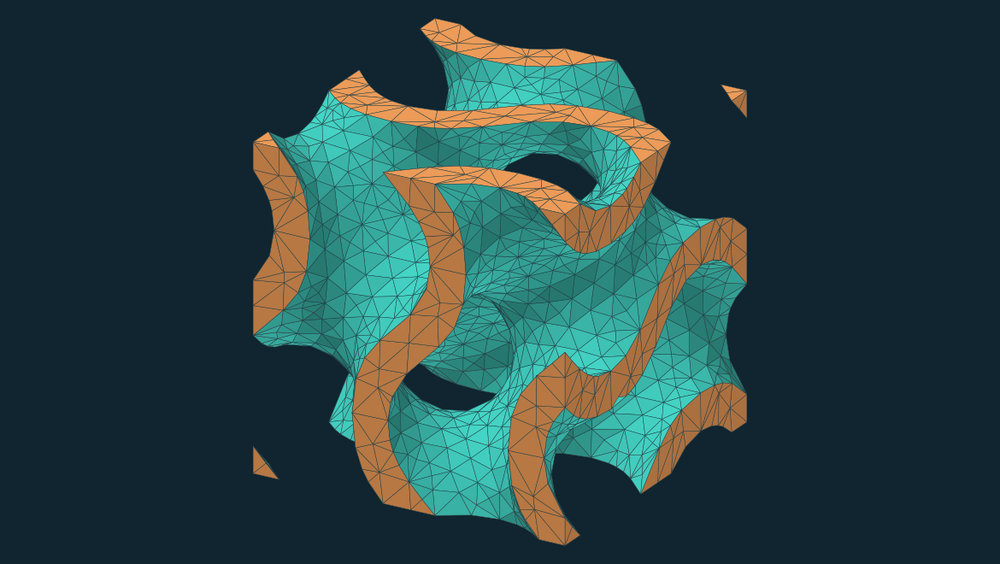

# Meshers

[](https://kmarchais.github.io/meshers/)

Meshers generates tetrahedral meshes from implicit solids for finite element analysis. Use built-in TPMS fields or supply a function. Named intersections retain boundary labels and feature edges.

```sh
python -m pip install "meshers[io]"
```

```python
import meshers

mesh = meshers.generate("gyroid", band=(-0.5, 0.5), cells=12, periodic=(True, True, True))
mesh.write_vtkhdf("gyroid.vtkhdf")
```

Use `meshers` alone for NumPy arrays. Published 0.2.1 wheels support Python 3.10+. Development builds require Python 3.11+.

- [Documentation and examples](https://kmarchais.github.io/meshers/)
- [Python API](https://kmarchais.github.io/meshers/api/python/) · [Rust API](https://kmarchais.github.io/meshers/rust/meshers_core/)
- [Quality and limits](docs/site/quality.md) · [FEA verification](docs/site/solver-verification.md) · [Performance checks](docs/site/performance.md)

## Develop

Use uv, Python 3.11+ and Rust 1.95+.

```sh
uv sync --locked --all-packages --group docs
uv run pytest crates/meshers-python/tests tools/tests
uv run ruff check
uv run ruff format --check
uv run ty check
cargo test --locked --release
uv run --group docs python tools/build_docs.py
```

[Contributing](docs/site/contributing.md) · [Release checks](docs/site/release.md)

The **Microgen F-rep coverage** workflow builds a release wheel and checks four meshes after VTU export. To run the 69-case inventory, select **Run workflow** and choose **inventory**. The artifact records each case's geometry checks, native rejection, or audit error.

## License

Meshers is [MIT licensed](LICENSE). Python distributions include the bundled dependencies’ license notices.
