# Benchmark history

Open a record for its timing plot, quality gates and raw samples.

Compare times within a run. A REFERENCE compares one source revision to itself.

| Record | Suite | Result | Platform |
| --- | --- | --- | --- |
| [v0.2.0-rc-reference](benchmarks/v0.2.0-rc-reference.md) | release | REFERENCE | macOS-26.5.1-arm64-arm-64bit / arm64 |
| [pr6-22cd611-quality-regression](benchmarks/pr6-22cd611-quality-regression.md) | pr | FAIL | Linux-7.0.0-1019-azure-x86_64-with-glibc2.43 / x86_64 |
| [pr6-0c3c4c1-quality-recovery](benchmarks/pr6-0c3c4c1-quality-recovery.md) | pr | PASS | macOS-26.5.1-arm64-arm-64bit / arm64 |
| [v0.2.0](benchmarks/v0.2.0.md) | release | PASS | Linux-7.0.0-1019-azure-x86_64-with-glibc2.43 / x86_64 |
| [mapped-sweep-de57fa3](benchmarks/mapped-sweep-de57fa3.md) | release | PASS | macOS-26.5.1-arm64-arm-64bit / arm64 |
| [v0.2.1-rc.1](benchmarks/v0.2.1-rc.1.md) | release | PASS | macOS-26.5.1-arm64-arm-64bit / arm64 |
| [v0.2.1](benchmarks/v0.2.1.md) | release | PASS | Linux-7.0.0-1016-aws-x86_64-with-glibc2.43 / x86_64 |

See [regression protocol and release instructions](performance.md) for thresholds and how to add a release record.
