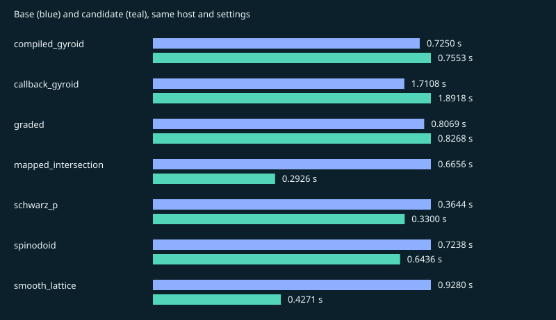

# pr6-0c3c4c1-quality-recovery

Result: **PASS**. Suite: `pr`.

Source: `d1324b7e1e94d4ced47a781e4c118d617b0589d5` → `0c3c4c10011e524b952e6e0432d3572e0daaaf22`.

Host: `macOS-26.5.1-arm64-arm-64bit`, `arm64`, 10 CPUs. One numerical thread.

Recorded: 2026-11-12T11:24:30.003945+00:00. 5 measured fresh-process pairs after one discarded warmup pair.

[Raw samples, versions and native hashes](pr6-0c3c4c1-quality-recovery.json) · [All records](../benchmark-history.md)

Absolute times from different hosts are not a release-to-release speed ranking.

Quality and sampled surface error describe linear corners/parent surfaces, including Tet10. Tet10 volumes integrate the curved mapping and its Jacobians are sampled for positivity. These are regression checks, not geometry or FEA certification.

## compiled_gyroid

| Metric | Base | Candidate |
| --- | ---: | ---: |
| seconds | 0.725017 | 0.75534 |
| peak_rss_bytes | 8.5033e+07 | 8.5246e+07 |
| tetrahedra | 70403 | 70403 |
| nodes | 17849 | 17849 |
| volume | 0.324291 | 0.324292 |
| surface_error | 0.00134556 | 0.00137909 |
| quality_min | 0.30807 | 0.313961 |
| quality_p05 | 0.575808 | 0.572485 |
| quality_p10 | 0.613587 | 0.61151 |
| quality_median | 0.857042 | 0.855276 |
| quality_mean | 0.810234 | 0.808762 |
| quality_p90 | 0.938212 | 0.937724 |
| quality_max | 0.997426 | 0.996577 |

## callback_gyroid

| Metric | Base | Candidate |
| --- | ---: | ---: |
| seconds | 1.71084 | 1.89178 |
| peak_rss_bytes | 8.73103e+07 | 8.7638e+07 |
| tetrahedra | 70403 | 70403 |
| nodes | 17849 | 17849 |
| volume | 0.324291 | 0.324292 |
| surface_error | 0.00134556 | 0.00137909 |
| quality_min | 0.30807 | 0.313961 |
| quality_p05 | 0.575808 | 0.572485 |
| quality_p10 | 0.613587 | 0.61151 |
| quality_median | 0.857042 | 0.855276 |
| quality_mean | 0.810234 | 0.808762 |
| quality_p90 | 0.938212 | 0.937724 |
| quality_max | 0.997426 | 0.996577 |

## graded

| Metric | Base | Candidate |
| --- | ---: | ---: |
| seconds | 0.806888 | 0.826833 |
| peak_rss_bytes | 8.38697e+07 | 8.4181e+07 |
| tetrahedra | 65506 | 65506 |
| nodes | 17493 | 17493 |
| volume | 0.275172 | 0.275172 |
| surface_error | 0.00163884 | 0.00165087 |
| quality_min | 0.173362 | 0.173279 |
| quality_p05 | 0.556023 | 0.55437 |
| quality_p10 | 0.596767 | 0.595505 |
| quality_median | 0.815391 | 0.813623 |
| quality_mean | 0.785111 | 0.784113 |
| quality_p90 | 0.933425 | 0.933089 |
| quality_max | 0.998895 | 0.998895 |

## mapped_intersection

| Metric | Base | Candidate |
| --- | ---: | ---: |
| seconds | 0.665551 | 0.292625 |
| peak_rss_bytes | 1.14885e+08 | 1.15294e+08 |
| tetrahedra | 63648 | 63648 |
| nodes | 12079 | 12079 |
| volume | 0.40768 | 0.40768 |
| surface_error | 8.44181e-05 | 8.44181e-05 |
| quality_min | 0.621393 | 0.621393 |
| quality_p05 | 0.70402 | 0.70402 |
| quality_p10 | 0.886322 | 0.886322 |
| quality_median | 0.917811 | 0.917811 |
| quality_mean | 0.905994 | 0.905994 |
| quality_p90 | 0.964151 | 0.964151 |
| quality_max | 0.973865 | 0.973865 |

## schwarz_p

| Metric | Base | Candidate |
| --- | ---: | ---: |
| seconds | 0.364401 | 0.330046 |
| peak_rss_bytes | 8.38369e+07 | 8.39844e+07 |
| tetrahedra | 90792 | 90792 |
| nodes | 17857 | 17857 |
| volume | 0.499978 | 0.499978 |
| surface_error | 0.00191843 | 0.00191916 |
| quality_min | 0.445642 | 0.459816 |
| quality_p05 | 0.629268 | 0.62826 |
| quality_p10 | 0.735744 | 0.734338 |
| quality_median | 0.929516 | 0.929516 |
| quality_mean | 0.887283 | 0.887058 |
| quality_p90 | 0.929516 | 0.929516 |
| quality_max | 0.998577 | 0.998727 |

## spinodoid

| Metric | Base | Candidate |
| --- | ---: | ---: |
| seconds | 0.723758 | 0.64357 |
| peak_rss_bytes | 9.30284e+07 | 9.31922e+07 |
| tetrahedra | 107079 | 107079 |
| nodes | 22163 | 22163 |
| volume | 0.583063 | 0.583064 |
| surface_error | 0.0032829 | 0.0032829 |
| quality_min | 0.221429 | 0.225115 |
| quality_p05 | 0.620003 | 0.617792 |
| quality_p10 | 0.701036 | 0.697967 |
| quality_median | 0.929516 | 0.929516 |
| quality_mean | 0.873331 | 0.872599 |
| quality_p90 | 0.938457 | 0.938455 |
| quality_max | 0.998356 | 0.998465 |

## smooth_lattice

| Metric | Base | Candidate |
| --- | ---: | ---: |
| seconds | 0.927969 | 0.427056 |
| peak_rss_bytes | 6.83868e+07 | 6.8649e+07 |
| tetrahedra | 43392 | 43392 |
| nodes | 11012 | 11012 |
| volume | 0.197101 | 0.197098 |
| surface_error | 0.00346953 | 0.00340924 |
| quality_min | 0.436992 | 0.433806 |
| quality_p05 | 0.568782 | 0.566203 |
| quality_p10 | 0.616618 | 0.615008 |
| quality_median | 0.850221 | 0.849268 |
| quality_mean | 0.81473 | 0.814284 |
| quality_p90 | 0.941482 | 0.94174 |
| quality_max | 0.994638 | 0.99463 |
