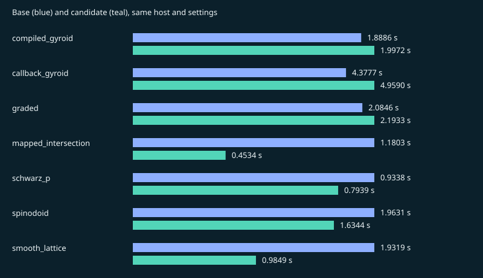

# pr6-22cd611-quality-regression

Result: **FAIL**. Suite: `pr`.

Source: `d1324b7e1e94d4ced47a781e4c118d617b0589d5` → `bae6ece6b61abd5de8b676f79adc9de7a3fd1942`.

Host: `Linux-7.0.0-1019-azure-x86_64-with-glibc2.43`, `x86_64`, 4 CPUs. One numerical thread.

Recorded: 2026-11-12T10:58:18.286759+00:00. 5 measured fresh-process pairs after one discarded warmup pair.

[Raw samples, versions and native hashes](pr6-22cd611-quality-regression.json) · [All records](../benchmark-history.md)

Absolute times from different hosts are not a release-to-release speed ranking.

Quality and sampled surface error describe linear corners/parent surfaces, including Tet10. Tet10 volumes integrate the curved mapping and its Jacobians are sampled for positivity. These are regression checks, not geometry or FEA certification.

## compiled_gyroid

| Metric | Base | Candidate |
| --- | ---: | ---: |
| seconds | 1.88856 | 1.99719 |
| peak_rss_bytes | 8.17684e+07 | 8.2473e+07 |
| tetrahedra | 70403 | 70403 |
| nodes | 17849 | 17849 |
| volume | 0.324291 | 0.324291 |
| surface_error | 0.00134556 | 0.00134556 |
| quality_min | 0.30807 | 0.30807 |
| quality_p05 | 0.575808 | 0.575808 |
| quality_p10 | 0.613587 | 0.613587 |
| quality_median | 0.857042 | 0.857042 |
| quality_mean | 0.810234 | 0.810234 |
| quality_p90 | 0.938212 | 0.938212 |
| quality_max | 0.997426 | 0.997426 |

## callback_gyroid

| Metric | Base | Candidate |
| --- | ---: | ---: |
| seconds | 4.37773 | 4.95904 |
| peak_rss_bytes | 8.22682e+07 | 8.26491e+07 |
| tetrahedra | 70403 | 70403 |
| nodes | 17849 | 17849 |
| volume | 0.324291 | 0.324291 |
| surface_error | 0.00134556 | 0.00134556 |
| quality_min | 0.30807 | 0.30807 |
| quality_p05 | 0.575808 | 0.575808 |
| quality_p10 | 0.613587 | 0.613587 |
| quality_median | 0.857042 | 0.857042 |
| quality_mean | 0.810234 | 0.810234 |
| quality_p90 | 0.938212 | 0.938212 |
| quality_max | 0.997426 | 0.997426 |

## graded

| Metric | Base | Candidate |
| --- | ---: | ---: |
| seconds | 2.08457 | 2.19331 |
| peak_rss_bytes | 8.28416e+07 | 8.36813e+07 |
| tetrahedra | 65506 | 65506 |
| nodes | 17493 | 17493 |
| volume | 0.275172 | 0.275172 |
| surface_error | 0.00163884 | 0.00163884 |
| quality_min | 0.173362 | 0.173362 |
| quality_p05 | 0.556023 | 0.556023 |
| quality_p10 | 0.596767 | 0.596767 |
| quality_median | 0.815391 | 0.815391 |
| quality_mean | 0.785111 | 0.785111 |
| quality_p90 | 0.933425 | 0.933425 |
| quality_max | 0.998895 | 0.998895 |

## mapped_intersection

| Metric | Base | Candidate |
| --- | ---: | ---: |
| seconds | 1.18026 | 0.453431 |
| peak_rss_bytes | 9.53344e+07 | 9.583e+07 |
| tetrahedra | 63648 | 63648 |
| nodes | 12079 | 12079 |
| volume | 0.40768 | 0.40768 |
| surface_error | 8.44181e-05 | 8.44181e-05 |
| quality_min | 0.621393 | 0.621393 |
| quality_p05 | 0.70402 | 0.70402 |
| quality_p10 | 0.886322 | 0.886322 |
| quality_median | 0.917811 | 0.917811 |
| quality_mean | 0.905994 | 0.905994 |
| quality_p90 | 0.964151 | 0.964151 |
| quality_max | 0.973865 | 0.973865 |

## schwarz_p

| Metric | Base | Candidate |
| --- | ---: | ---: |
| seconds | 0.933755 | 0.793904 |
| peak_rss_bytes | 8.79124e+07 | 8.78838e+07 |
| tetrahedra | 90792 | 90792 |
| nodes | 17857 | 17857 |
| volume | 0.499978 | 0.499978 |
| surface_error | 0.00191843 | 0.00191843 |
| quality_min | 0.445642 | 0.445642 |
| quality_p05 | 0.629268 | 0.629268 |
| quality_p10 | 0.735744 | 0.735744 |
| quality_median | 0.929516 | 0.929516 |
| quality_mean | 0.887283 | 0.887283 |
| quality_p90 | 0.929516 | 0.929516 |
| quality_max | 0.998577 | 0.998577 |

## spinodoid

| Metric | Base | Candidate |
| --- | ---: | ---: |
| seconds | 1.96308 | 1.63442 |
| peak_rss_bytes | 9.35567e+07 | 9.44046e+07 |
| tetrahedra | 107079 | 107079 |
| nodes | 22163 | 22163 |
| volume | 0.583063 | 0.583063 |
| surface_error | 0.0032829 | 0.0032829 |
| quality_min | 0.221429 | 0.221429 |
| quality_p05 | 0.620003 | 0.620003 |
| quality_p10 | 0.701036 | 0.701036 |
| quality_median | 0.929516 | 0.929516 |
| quality_mean | 0.873331 | 0.873331 |
| quality_p90 | 0.938457 | 0.938457 |
| quality_max | 0.998356 | 0.998356 |

## smooth_lattice

| Metric | Base | Candidate |
| --- | ---: | ---: |
| seconds | 1.93194 | 0.984889 |
| peak_rss_bytes | 7.21551e+07 | 7.27532e+07 |
| tetrahedra | 43392 | 43392 |
| nodes | 11012 | 11012 |
| volume | 0.197101 | 0.197099 |
| surface_error | 0.00346953 | 0.00340924 |
| quality_min | 0.436992 | 0.424501 |
| quality_p05 | 0.568782 | 0.569 |
| quality_p10 | 0.616618 | 0.616607 |
| quality_median | 0.850221 | 0.850044 |
| quality_mean | 0.81473 | 0.814629 |
| quality_p90 | 0.941482 | 0.941518 |
| quality_max | 0.994638 | 0.99463 |

- quality_min decreased: 0.436992 -> 0.424501
- sample 1: quality_min decreased by more than 1%
- sample 2: quality_min decreased by more than 1%
- sample 3: quality_min decreased by more than 1%
- sample 4: quality_min decreased by more than 1%
- sample 5: quality_min decreased by more than 1%
