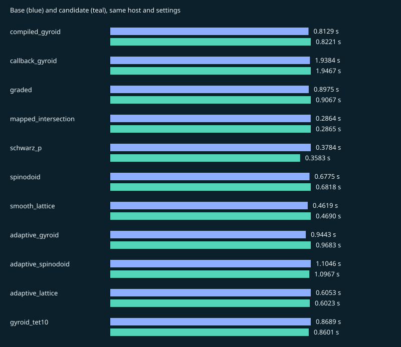

# v0.2.0-rc-reference

Result: **REFERENCE**. Suite: `release`.

Source: `afc49e583a0450454b02440557f39b89bbc39ca6` → `afc49e583a0450454b02440557f39b89bbc39ca6`.

Host: `macOS-26.5.1-arm64-arm-64bit`, `arm64`, 10 CPUs. One numerical thread.

Recorded: 2026-11-12T10:40:15.902767+00:00. 5 measured fresh-process pairs after one discarded warmup pair.

[Raw samples, versions and native hashes](v0.2.0-rc-reference.json) · [All records](../benchmark-history.md)

Absolute times from different hosts are not a release-to-release speed ranking.

Quality and sampled surface error describe linear corners/parent surfaces, including Tet10. Tet10 volumes integrate the curved mapping and its Jacobians are sampled for positivity. These are regression checks, not geometry or FEA certification.

**Both sides loaded the same native binary.** Timings still include Python preparation. Inspect the source identities before interpreting a speedup as a native-code improvement.

## compiled_gyroid

| Metric | Base | Candidate |
| --- | ---: | ---: |
| seconds | 0.812892 | 0.822141 |
| peak_rss_bytes | 8.53606e+07 | 8.53115e+07 |
| tetrahedra | 70403 | 70403 |
| nodes | 17849 | 17849 |
| volume | 0.324291 | 0.324291 |
| surface_error | 0.00134556 | 0.00134556 |
| quality_min | 0.30807 | 0.30807 |
| quality_p05 | 0.575808 | 0.575808 |
| quality_p10 | 0.613587 | 0.613587 |
| quality_median | 0.857042 | 0.857042 |
| quality_mean | 0.810234 | 0.810234 |
| quality_p90 | 0.938212 | 0.938212 |
| quality_max | 0.997426 | 0.997426 |

## callback_gyroid

| Metric | Base | Candidate |
| --- | ---: | ---: |
| seconds | 1.93842 | 1.94672 |
| peak_rss_bytes | 8.74578e+07 | 8.75069e+07 |
| tetrahedra | 70403 | 70403 |
| nodes | 17849 | 17849 |
| volume | 0.324291 | 0.324291 |
| surface_error | 0.00134556 | 0.00134556 |
| quality_min | 0.30807 | 0.30807 |
| quality_p05 | 0.575808 | 0.575808 |
| quality_p10 | 0.613587 | 0.613587 |
| quality_median | 0.857042 | 0.857042 |
| quality_mean | 0.810234 | 0.810234 |
| quality_p90 | 0.938212 | 0.938212 |
| quality_max | 0.997426 | 0.997426 |

## graded

| Metric | Base | Candidate |
| --- | ---: | ---: |
| seconds | 0.897508 | 0.906737 |
| peak_rss_bytes | 8.40827e+07 | 8.40008e+07 |
| tetrahedra | 65506 | 65506 |
| nodes | 17493 | 17493 |
| volume | 0.275172 | 0.275172 |
| surface_error | 0.00163884 | 0.00163884 |
| quality_min | 0.173362 | 0.173362 |
| quality_p05 | 0.556023 | 0.556023 |
| quality_p10 | 0.596767 | 0.596767 |
| quality_median | 0.815391 | 0.815391 |
| quality_mean | 0.785111 | 0.785111 |
| quality_p90 | 0.933425 | 0.933425 |
| quality_max | 0.998895 | 0.998895 |

## mapped_intersection

| Metric | Base | Candidate |
| --- | ---: | ---: |
| seconds | 0.286425 | 0.286519 |
| peak_rss_bytes | 1.15261e+08 | 1.15442e+08 |
| tetrahedra | 63648 | 63648 |
| nodes | 12079 | 12079 |
| volume | 0.40768 | 0.40768 |
| surface_error | 8.44181e-05 | 8.44181e-05 |
| quality_min | 0.621393 | 0.621393 |
| quality_p05 | 0.70402 | 0.70402 |
| quality_p10 | 0.886322 | 0.886322 |
| quality_median | 0.917811 | 0.917811 |
| quality_mean | 0.905994 | 0.905994 |
| quality_p90 | 0.964151 | 0.964151 |
| quality_max | 0.973865 | 0.973865 |

## schwarz_p

| Metric | Base | Candidate |
| --- | ---: | ---: |
| seconds | 0.378434 | 0.358284 |
| peak_rss_bytes | 8.41646e+07 | 8.41646e+07 |
| tetrahedra | 90792 | 90792 |
| nodes | 17857 | 17857 |
| volume | 0.499978 | 0.499978 |
| surface_error | 0.00191843 | 0.00191843 |
| quality_min | 0.445642 | 0.445642 |
| quality_p05 | 0.629268 | 0.629268 |
| quality_p10 | 0.735744 | 0.735744 |
| quality_median | 0.929516 | 0.929516 |
| quality_mean | 0.887283 | 0.887283 |
| quality_p90 | 0.929516 | 0.929516 |
| quality_max | 0.998577 | 0.998577 |

## spinodoid

| Metric | Base | Candidate |
| --- | ---: | ---: |
| seconds | 0.677536 | 0.681823 |
| peak_rss_bytes | 9.34052e+07 | 9.33396e+07 |
| tetrahedra | 107079 | 107079 |
| nodes | 22163 | 22163 |
| volume | 0.583063 | 0.583063 |
| surface_error | 0.0032829 | 0.0032829 |
| quality_min | 0.221429 | 0.221429 |
| quality_p05 | 0.620003 | 0.620003 |
| quality_p10 | 0.701036 | 0.701036 |
| quality_median | 0.929516 | 0.929516 |
| quality_mean | 0.873331 | 0.873331 |
| quality_p90 | 0.938457 | 0.938457 |
| quality_max | 0.998356 | 0.998356 |

## smooth_lattice

| Metric | Base | Candidate |
| --- | ---: | ---: |
| seconds | 0.461878 | 0.469015 |
| peak_rss_bytes | 6.88292e+07 | 6.88128e+07 |
| tetrahedra | 43392 | 43392 |
| nodes | 11012 | 11012 |
| volume | 0.197099 | 0.197099 |
| surface_error | 0.00340924 | 0.00340924 |
| quality_min | 0.424501 | 0.424501 |
| quality_p05 | 0.569 | 0.569 |
| quality_p10 | 0.616607 | 0.616607 |
| quality_median | 0.850044 | 0.850044 |
| quality_mean | 0.814629 | 0.814629 |
| quality_p90 | 0.941518 | 0.941518 |
| quality_max | 0.99463 | 0.99463 |

## adaptive_gyroid

| Metric | Base | Candidate |
| --- | ---: | ---: |
| seconds | 0.944289 | 0.968286 |
| peak_rss_bytes | 1.01859e+08 | 1.01761e+08 |
| tetrahedra | 30733 | 30733 |
| nodes | 8531 | 8531 |
| volume | 0.324354 | 0.324354 |
| surface_error | 0.00132472 | 0.00132472 |
| quality_min | 0.383817 | 0.383817 |
| quality_p05 | 0.550308 | 0.550308 |
| quality_p10 | 0.583511 | 0.583511 |
| quality_median | 0.721516 | 0.721516 |
| quality_mean | 0.724632 | 0.724632 |
| quality_p90 | 0.871431 | 0.871431 |
| quality_max | 0.995563 | 0.995563 |

## adaptive_spinodoid

| Metric | Base | Candidate |
| --- | ---: | ---: |
| seconds | 1.10461 | 1.09666 |
| peak_rss_bytes | 1.3697e+08 | 1.37036e+08 |
| tetrahedra | 28902 | 28902 |
| nodes | 7084 | 7084 |
| volume | 0.583167 | 0.583167 |
| surface_error | 0.00174486 | 0.00174486 |
| quality_min | 0.382041 | 0.382041 |
| quality_p05 | 0.565977 | 0.565977 |
| quality_p10 | 0.599552 | 0.599552 |
| quality_median | 0.741887 | 0.741887 |
| quality_mean | 0.742615 | 0.742615 |
| quality_p90 | 0.88688 | 0.88688 |
| quality_max | 0.99888 | 0.99888 |

## adaptive_lattice

| Metric | Base | Candidate |
| --- | ---: | ---: |
| seconds | 0.605335 | 0.602307 |
| peak_rss_bytes | 8.07895e+07 | 8.08223e+07 |
| tetrahedra | 20942 | 20942 |
| nodes | 5813 | 5813 |
| volume | 0.196878 | 0.196878 |
| surface_error | 0.00164041 | 0.00164041 |
| quality_min | 0.445331 | 0.445331 |
| quality_p05 | 0.564943 | 0.564943 |
| quality_p10 | 0.595555 | 0.595555 |
| quality_median | 0.733231 | 0.733231 |
| quality_mean | 0.734726 | 0.734726 |
| quality_p90 | 0.879621 | 0.879621 |
| quality_max | 0.99704 | 0.99704 |

## gyroid_tet10

| Metric | Base | Candidate |
| --- | ---: | ---: |
| seconds | 0.868921 | 0.86008 |
| peak_rss_bytes | 1.06201e+08 | 1.06234e+08 |
| tetrahedra | 70403 | 70403 |
| nodes | 116856 | 116856 |
| volume | 0.323563 | 0.323563 |
| surface_error | 0.00134556 | 0.00134556 |
| quality_min | 0.30807 | 0.30807 |
| quality_p05 | 0.575808 | 0.575808 |
| quality_p10 | 0.613587 | 0.613587 |
| quality_median | 0.857042 | 0.857042 |
| quality_mean | 0.810234 | 0.810234 |
| quality_p90 | 0.938212 | 0.938212 |
| quality_max | 0.997426 | 0.997426 |
