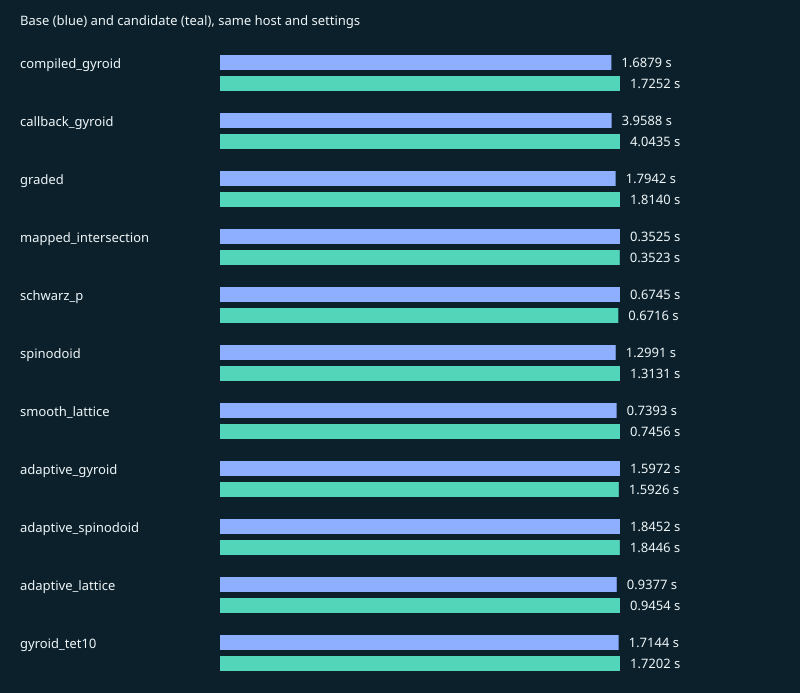

# v0.2.0

Result: **PASS**. Suite: `release`.

Source: `afc49e583a0450454b02440557f39b89bbc39ca6` → `a0da5d257a39298e505ffca1b90c37b3ff83de77`.

Host: `Linux-7.0.0-1019-azure-x86_64-with-glibc2.43`, `x86_64`, 4 CPUs. One numerical thread.

Recorded: 2026-11-12T12:15:05.351684+00:00. 5 measured fresh-process pairs after one discarded warmup pair.

[Raw samples, versions and native hashes](v0.2.0.json) · [All records](../benchmark-history.md)

Absolute times from different hosts are not a release-to-release speed ranking.

Quality and sampled surface error describe linear corners/parent surfaces, including Tet10. Tet10 volumes integrate the curved mapping and its Jacobians are sampled for positivity. These are regression checks, not geometry or FEA certification.

## compiled_gyroid

| Metric | Base | Candidate |
| --- | ---: | ---: |
| seconds | 1.68795 | 1.72517 |
| peak_rss_bytes | 8.24934e+07 | 8.24484e+07 |
| tetrahedra | 70403 | 70403 |
| nodes | 17849 | 17849 |
| volume | 0.324291 | 0.324292 |
| surface_error | 0.00134556 | 0.00137909 |
| quality_min | 0.30807 | 0.313961 |
| quality_p05 | 0.575808 | 0.572485 |
| quality_p10 | 0.613587 | 0.61151 |
| quality_median | 0.857042 | 0.855276 |
| quality_mean | 0.810234 | 0.808762 |
| quality_p90 | 0.938212 | 0.937724 |
| quality_max | 0.997426 | 0.996577 |

## callback_gyroid

| Metric | Base | Candidate |
| --- | ---: | ---: |
| seconds | 3.95877 | 4.04346 |
| peak_rss_bytes | 8.26491e+07 | 8.2817e+07 |
| tetrahedra | 70403 | 70403 |
| nodes | 17849 | 17849 |
| volume | 0.324291 | 0.324292 |
| surface_error | 0.00134556 | 0.00137909 |
| quality_min | 0.30807 | 0.313961 |
| quality_p05 | 0.575808 | 0.572485 |
| quality_p10 | 0.613587 | 0.61151 |
| quality_median | 0.857042 | 0.855276 |
| quality_mean | 0.810234 | 0.808762 |
| quality_p90 | 0.938212 | 0.937724 |
| quality_max | 0.997426 | 0.996577 |

## graded

| Metric | Base | Candidate |
| --- | ---: | ---: |
| seconds | 1.79422 | 1.81398 |
| peak_rss_bytes | 8.11295e+07 | 8.37714e+07 |
| tetrahedra | 65506 | 65506 |
| nodes | 17493 | 17493 |
| volume | 0.275172 | 0.275172 |
| surface_error | 0.00163884 | 0.00165087 |
| quality_min | 0.173362 | 0.173279 |
| quality_p05 | 0.556023 | 0.55437 |
| quality_p10 | 0.596767 | 0.595505 |
| quality_median | 0.815391 | 0.813623 |
| quality_mean | 0.785111 | 0.784113 |
| quality_p90 | 0.933425 | 0.933089 |
| quality_max | 0.998895 | 0.998895 |

## mapped_intersection

| Metric | Base | Candidate |
| --- | ---: | ---: |
| seconds | 0.352515 | 0.352342 |
| peak_rss_bytes | 9.583e+07 | 9.58996e+07 |
| tetrahedra | 63648 | 63648 |
| nodes | 12079 | 12079 |
| volume | 0.40768 | 0.40768 |
| surface_error | 8.44181e-05 | 8.44181e-05 |
| quality_min | 0.621393 | 0.621393 |
| quality_p05 | 0.70402 | 0.70402 |
| quality_p10 | 0.886322 | 0.886322 |
| quality_median | 0.917811 | 0.917811 |
| quality_mean | 0.905994 | 0.905994 |
| quality_p90 | 0.964151 | 0.964151 |
| quality_max | 0.973865 | 0.973865 |

## schwarz_p

| Metric | Base | Candidate |
| --- | ---: | ---: |
| seconds | 0.674479 | 0.671602 |
| peak_rss_bytes | 8.78428e+07 | 8.79043e+07 |
| tetrahedra | 90792 | 90792 |
| nodes | 17857 | 17857 |
| volume | 0.499978 | 0.499978 |
| surface_error | 0.00191843 | 0.00191916 |
| quality_min | 0.445642 | 0.459816 |
| quality_p05 | 0.629268 | 0.62826 |
| quality_p10 | 0.735744 | 0.734338 |
| quality_median | 0.929516 | 0.929516 |
| quality_mean | 0.887283 | 0.887058 |
| quality_p90 | 0.929516 | 0.929516 |
| quality_max | 0.998577 | 0.998727 |

## spinodoid

| Metric | Base | Candidate |
| --- | ---: | ---: |
| seconds | 1.29911 | 1.31312 |
| peak_rss_bytes | 9.51951e+07 | 9.43514e+07 |
| tetrahedra | 107079 | 107079 |
| nodes | 22163 | 22163 |
| volume | 0.583063 | 0.583064 |
| surface_error | 0.0032829 | 0.0032829 |
| quality_min | 0.221429 | 0.225115 |
| quality_p05 | 0.620003 | 0.617792 |
| quality_p10 | 0.701036 | 0.697967 |
| quality_median | 0.929516 | 0.929516 |
| quality_mean | 0.873331 | 0.872599 |
| quality_p90 | 0.938457 | 0.938455 |
| quality_max | 0.998356 | 0.998465 |

## smooth_lattice

| Metric | Base | Candidate |
| --- | ---: | ---: |
| seconds | 0.739347 | 0.745636 |
| peak_rss_bytes | 7.27695e+07 | 7.28515e+07 |
| tetrahedra | 43392 | 43392 |
| nodes | 11012 | 11012 |
| volume | 0.197099 | 0.197098 |
| surface_error | 0.00340924 | 0.00340924 |
| quality_min | 0.424501 | 0.433806 |
| quality_p05 | 0.569 | 0.566203 |
| quality_p10 | 0.616607 | 0.615008 |
| quality_median | 0.850044 | 0.849268 |
| quality_mean | 0.814629 | 0.814284 |
| quality_p90 | 0.941518 | 0.94174 |
| quality_max | 0.99463 | 0.99463 |

## adaptive_gyroid

| Metric | Base | Candidate |
| --- | ---: | ---: |
| seconds | 1.59725 | 1.59258 |
| peak_rss_bytes | 9.3225e+07 | 9.35117e+07 |
| tetrahedra | 30716 | 30716 |
| nodes | 8527 | 8527 |
| volume | 0.324356 | 0.324356 |
| surface_error | 0.00130827 | 0.00130827 |
| quality_min | 0.383795 | 0.406609 |
| quality_p05 | 0.551405 | 0.548898 |
| quality_p10 | 0.583201 | 0.581287 |
| quality_median | 0.721733 | 0.72067 |
| quality_mean | 0.724824 | 0.723785 |
| quality_p90 | 0.871671 | 0.870819 |
| quality_max | 0.993796 | 0.996438 |

## adaptive_spinodoid

| Metric | Base | Candidate |
| --- | ---: | ---: |
| seconds | 1.84521 | 1.84455 |
| peak_rss_bytes | 1.09752e+08 | 1.10719e+08 |
| tetrahedra | 28943 | 28943 |
| nodes | 7092 | 7092 |
| volume | 0.583167 | 0.583168 |
| surface_error | 0.00164593 | 0.00170564 |
| quality_min | 0.380813 | 0.390608 |
| quality_p05 | 0.565481 | 0.563033 |
| quality_p10 | 0.59925 | 0.597264 |
| quality_median | 0.741095 | 0.740109 |
| quality_mean | 0.742119 | 0.740964 |
| quality_p90 | 0.886809 | 0.886409 |
| quality_max | 0.998186 | 0.999125 |

## adaptive_lattice

| Metric | Base | Candidate |
| --- | ---: | ---: |
| seconds | 0.937681 | 0.945357 |
| peak_rss_bytes | 8.04127e+07 | 8.047e+07 |
| tetrahedra | 20978 | 20978 |
| nodes | 5820 | 5820 |
| volume | 0.196877 | 0.196877 |
| surface_error | 0.0016952 | 0.0016952 |
| quality_min | 0.439129 | 0.453644 |
| quality_p05 | 0.563964 | 0.560521 |
| quality_p10 | 0.595484 | 0.593024 |
| quality_median | 0.732207 | 0.730743 |
| quality_mean | 0.734218 | 0.732878 |
| quality_p90 | 0.88012 | 0.879672 |
| quality_max | 0.999191 | 0.995715 |

## gyroid_tet10

| Metric | Base | Candidate |
| --- | ---: | ---: |
| seconds | 1.71439 | 1.72021 |
| peak_rss_bytes | 8.92191e+07 | 8.92109e+07 |
| tetrahedra | 70403 | 70403 |
| nodes | 116856 | 116856 |
| volume | 0.323563 | 0.323563 |
| surface_error | 0.00134556 | 0.00137909 |
| quality_min | 0.30807 | 0.313961 |
| quality_p05 | 0.575808 | 0.572485 |
| quality_p10 | 0.613587 | 0.61151 |
| quality_median | 0.857042 | 0.855276 |
| quality_mean | 0.810234 | 0.808762 |
| quality_p90 | 0.938212 | 0.937724 |
| quality_max | 0.997426 | 0.996577 |
