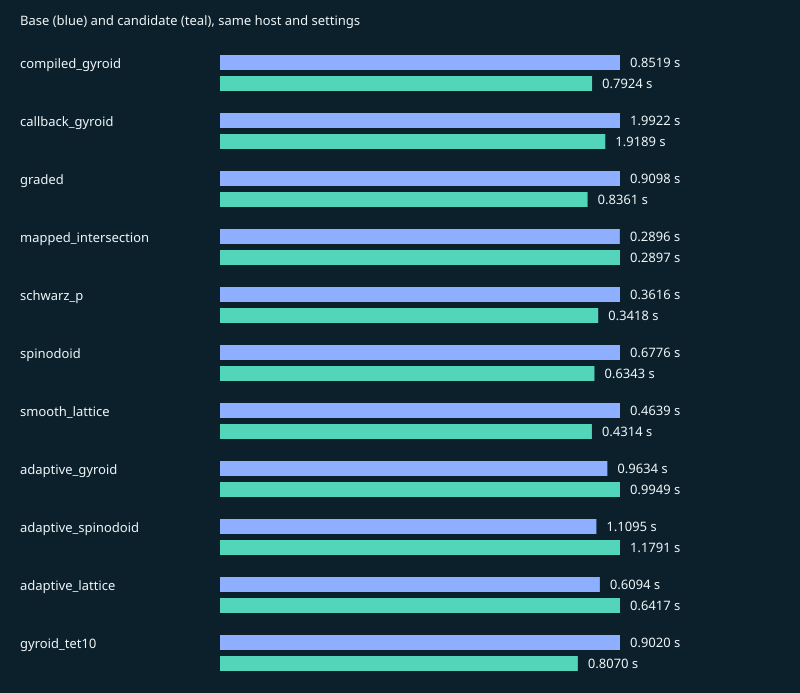

# v0.2.1-rc.1

Result: **PASS**. Suite: `release`.

Source: `a0da5d257a39298e505ffca1b90c37b3ff83de77` → `7654ccb058b8744430097e6c8e40ed0198bcaa77`.

Host: `macOS-26.5.1-arm64-arm-64bit`, `arm64`, 10 CPUs. One numerical thread.

Recorded: 2026-11-15T22:12:28.753600+00:00. 3 measured fresh-process pairs after one discarded warmup pair.

[Raw samples, versions and native hashes](v0.2.1-rc.1.json) · [All records](../benchmark-history.md)

Absolute times from different hosts are not a release-to-release speed ranking.

Quality and sampled surface error describe linear corners/parent surfaces, including Tet10. Tet10 volumes integrate the curved mapping and its Jacobians are sampled for positivity. These are regression checks, not geometry or FEA certification.

## compiled_gyroid

| Metric | Base | Candidate |
| --- | ---: | ---: |
| seconds | 0.851885 | 0.792413 |
| peak_rss_bytes | 8.48691e+07 | 8.5377e+07 |
| tetrahedra | 70403 | 70403 |
| nodes | 17849 | 17849 |
| volume | 0.324292 | 0.324292 |
| surface_error | 0.00137909 | 0.00137909 |
| quality_min | 0.313961 | 0.313961 |
| quality_p05 | 0.572485 | 0.572485 |
| quality_p10 | 0.61151 | 0.61151 |
| quality_median | 0.855276 | 0.855276 |
| quality_mean | 0.808762 | 0.808762 |
| quality_p90 | 0.937724 | 0.937724 |
| quality_max | 0.996577 | 0.996577 |

## callback_gyroid

| Metric | Base | Candidate |
| --- | ---: | ---: |
| seconds | 1.99224 | 1.9189 |
| peak_rss_bytes | 8.72448e+07 | 8.77527e+07 |
| tetrahedra | 70403 | 70403 |
| nodes | 17849 | 17849 |
| volume | 0.324292 | 0.324292 |
| surface_error | 0.00137909 | 0.00137909 |
| quality_min | 0.313961 | 0.313961 |
| quality_p05 | 0.572485 | 0.572485 |
| quality_p10 | 0.61151 | 0.61151 |
| quality_median | 0.855276 | 0.855276 |
| quality_mean | 0.808762 | 0.808762 |
| quality_p90 | 0.937724 | 0.937724 |
| quality_max | 0.996577 | 0.996577 |

## graded

| Metric | Base | Candidate |
| --- | ---: | ---: |
| seconds | 0.90979 | 0.836057 |
| peak_rss_bytes | 8.37222e+07 | 8.43121e+07 |
| tetrahedra | 65506 | 65506 |
| nodes | 17493 | 17493 |
| volume | 0.275172 | 0.275172 |
| surface_error | 0.00165087 | 0.00165087 |
| quality_min | 0.173279 | 0.173279 |
| quality_p05 | 0.55437 | 0.55437 |
| quality_p10 | 0.595505 | 0.595505 |
| quality_median | 0.813623 | 0.813623 |
| quality_mean | 0.784113 | 0.784113 |
| quality_p90 | 0.933089 | 0.933089 |
| quality_max | 0.998895 | 0.998895 |

## mapped_intersection

| Metric | Base | Candidate |
| --- | ---: | ---: |
| seconds | 0.289605 | 0.289707 |
| peak_rss_bytes | 1.15409e+08 | 1.16949e+08 |
| tetrahedra | 63648 | 63648 |
| nodes | 12079 | 12079 |
| volume | 0.40768 | 0.40768 |
| surface_error | 8.44181e-05 | 8.44181e-05 |
| quality_min | 0.621393 | 0.621393 |
| quality_p05 | 0.70402 | 0.70402 |
| quality_p10 | 0.886322 | 0.886322 |
| quality_median | 0.917811 | 0.917811 |
| quality_mean | 0.905994 | 0.905994 |
| quality_p90 | 0.964151 | 0.964151 |
| quality_max | 0.973865 | 0.973865 |

## schwarz_p

| Metric | Base | Candidate |
| --- | ---: | ---: |
| seconds | 0.361552 | 0.341838 |
| peak_rss_bytes | 8.3968e+07 | 8.43284e+07 |
| tetrahedra | 90792 | 90792 |
| nodes | 17857 | 17857 |
| volume | 0.499978 | 0.499978 |
| surface_error | 0.00191916 | 0.00191916 |
| quality_min | 0.459816 | 0.459816 |
| quality_p05 | 0.62826 | 0.62826 |
| quality_p10 | 0.734338 | 0.734338 |
| quality_median | 0.929516 | 0.929516 |
| quality_mean | 0.887058 | 0.887058 |
| quality_p90 | 0.929516 | 0.929516 |
| quality_max | 0.998727 | 0.998727 |

## spinodoid

| Metric | Base | Candidate |
| --- | ---: | ---: |
| seconds | 0.677587 | 0.634265 |
| peak_rss_bytes | 9.30447e+07 | 9.32413e+07 |
| tetrahedra | 107079 | 107079 |
| nodes | 22163 | 22163 |
| volume | 0.583064 | 0.583064 |
| surface_error | 0.0032829 | 0.0032829 |
| quality_min | 0.225115 | 0.225115 |
| quality_p05 | 0.617792 | 0.617792 |
| quality_p10 | 0.697967 | 0.697967 |
| quality_median | 0.929516 | 0.929516 |
| quality_mean | 0.872599 | 0.872599 |
| quality_p90 | 0.938455 | 0.938455 |
| quality_max | 0.998465 | 0.998465 |

## smooth_lattice

| Metric | Base | Candidate |
| --- | ---: | ---: |
| seconds | 0.463928 | 0.431361 |
| peak_rss_bytes | 6.84524e+07 | 6.89439e+07 |
| tetrahedra | 43392 | 43392 |
| nodes | 11012 | 11012 |
| volume | 0.197098 | 0.197098 |
| surface_error | 0.00340924 | 0.00340924 |
| quality_min | 0.433806 | 0.433806 |
| quality_p05 | 0.566203 | 0.566203 |
| quality_p10 | 0.615008 | 0.615008 |
| quality_median | 0.849268 | 0.849268 |
| quality_mean | 0.814284 | 0.814284 |
| quality_p90 | 0.94174 | 0.94174 |
| quality_max | 0.99463 | 0.99463 |

## adaptive_gyroid

| Metric | Base | Candidate |
| --- | ---: | ---: |
| seconds | 0.963423 | 0.994853 |
| peak_rss_bytes | 1.02318e+08 | 1.01597e+08 |
| tetrahedra | 30733 | 30733 |
| nodes | 8531 | 8531 |
| volume | 0.324354 | 0.324354 |
| surface_error | 0.00133271 | 0.00133271 |
| quality_min | 0.402167 | 0.402167 |
| quality_p05 | 0.549003 | 0.549003 |
| quality_p10 | 0.58144 | 0.58144 |
| quality_median | 0.720305 | 0.720305 |
| quality_mean | 0.72374 | 0.72374 |
| quality_p90 | 0.870812 | 0.870812 |
| quality_max | 0.99567 | 0.99567 |

## adaptive_spinodoid

| Metric | Base | Candidate |
| --- | ---: | ---: |
| seconds | 1.10951 | 1.17914 |
| peak_rss_bytes | 1.36364e+08 | 1.3697e+08 |
| tetrahedra | 28902 | 28902 |
| nodes | 7084 | 7084 |
| volume | 0.583167 | 0.583167 |
| surface_error | 0.00174486 | 0.00174486 |
| quality_min | 0.386807 | 0.386807 |
| quality_p05 | 0.562926 | 0.562926 |
| quality_p10 | 0.597323 | 0.597323 |
| quality_median | 0.740649 | 0.740649 |
| quality_mean | 0.74136 | 0.74136 |
| quality_p90 | 0.886953 | 0.886953 |
| quality_max | 0.9984 | 0.9984 |

## adaptive_lattice

| Metric | Base | Candidate |
| --- | ---: | ---: |
| seconds | 0.6094 | 0.64169 |
| peak_rss_bytes | 7.98392e+07 | 8.03471e+07 |
| tetrahedra | 20942 | 20942 |
| nodes | 5813 | 5813 |
| volume | 0.196878 | 0.196878 |
| surface_error | 0.00168804 | 0.00168804 |
| quality_min | 0.451853 | 0.451853 |
| quality_p05 | 0.561384 | 0.561384 |
| quality_p10 | 0.592882 | 0.592882 |
| quality_median | 0.731959 | 0.731959 |
| quality_mean | 0.733442 | 0.733442 |
| quality_p90 | 0.879745 | 0.879745 |
| quality_max | 0.997617 | 0.997617 |

## gyroid_tet10

| Metric | Base | Candidate |
| --- | ---: | ---: |
| seconds | 0.902049 | 0.807007 |
| peak_rss_bytes | 1.05726e+08 | 1.05791e+08 |
| tetrahedra | 70403 | 70403 |
| nodes | 116856 | 116856 |
| volume | 0.323563 | 0.323563 |
| surface_error | 0.00137909 | 0.00137909 |
| quality_min | 0.313961 | 0.313961 |
| quality_p05 | 0.572485 | 0.572485 |
| quality_p10 | 0.61151 | 0.61151 |
| quality_median | 0.855276 | 0.855276 |
| quality_mean | 0.808762 | 0.808762 |
| quality_p90 | 0.937724 | 0.937724 |
| quality_max | 0.996577 | 0.996577 |
