# v0.2.1

Result: **PASS**. Suite: `release`.

Source: `a0da5d257a39298e505ffca1b90c37b3ff83de77` → `aeacaf0c247696501c2be85c45157d8828eaa841`.

Host: `Linux-7.0.0-1016-aws-x86_64-with-glibc2.43`, `x86_64`, 4 CPUs. One numerical thread.

Recorded: 2026-11-15T22:45:19.133469+00:00. 5 measured fresh-process pairs after one discarded warmup pair.

[Raw samples, versions and native hashes](v0.2.1.json) · [All records](../benchmark-history.md)

For Tet10, quality and sampled surface error describe the linear parent. Volume integrates the curved element.

Median metrics by case

### compiled_gyroid

| Metric | Base | Candidate |
| --- | ---: | ---: |
| seconds | 1.44102 | 1.43836 |
| peak_rss_bytes | 8.12155e+07 | 8.14612e+07 |
| tetrahedra | 70403 | 70403 |
| nodes | 17849 | 17849 |
| volume | 0.324292 | 0.324292 |
| surface_error | 0.00137909 | 0.00137909 |
| quality_min | 0.313961 | 0.313961 |
| quality_p05 | 0.572485 | 0.572485 |
| quality_p10 | 0.61151 | 0.61151 |
| quality_median | 0.855276 | 0.855276 |
| quality_mean | 0.808762 | 0.808762 |
| quality_p90 | 0.937724 | 0.937724 |
| quality_max | 0.996577 | 0.996577 |

### callback_gyroid

| Metric | Base | Candidate |
| --- | ---: | ---: |
| seconds | 3.52786 | 3.52232 |
| peak_rss_bytes | 8.06871e+07 | 8.10107e+07 |
| tetrahedra | 70403 | 70403 |
| nodes | 17849 | 17849 |
| volume | 0.324292 | 0.324292 |
| surface_error | 0.00137909 | 0.00137909 |
| quality_min | 0.313961 | 0.313961 |
| quality_p05 | 0.572485 | 0.572485 |
| quality_p10 | 0.61151 | 0.61151 |
| quality_median | 0.855276 | 0.855276 |
| quality_mean | 0.808762 | 0.808762 |
| quality_p90 | 0.937724 | 0.937724 |
| quality_max | 0.996577 | 0.996577 |

### graded

| Metric | Base | Candidate |
| --- | ---: | ---: |
| seconds | 1.61339 | 1.60936 |
| peak_rss_bytes | 7.98966e+07 | 8.27146e+07 |
| tetrahedra | 65506 | 65506 |
| nodes | 17493 | 17493 |
| volume | 0.275172 | 0.275172 |
| surface_error | 0.00165087 | 0.00165087 |
| quality_min | 0.173279 | 0.173279 |
| quality_p05 | 0.55437 | 0.55437 |
| quality_p10 | 0.595505 | 0.595505 |
| quality_median | 0.813623 | 0.813623 |
| quality_mean | 0.784113 | 0.784113 |
| quality_p90 | 0.933089 | 0.933089 |
| quality_max | 0.998895 | 0.998895 |

### mapped_intersection

| Metric | Base | Candidate |
| --- | ---: | ---: |
| seconds | 0.408963 | 0.425441 |
| peak_rss_bytes | 9.45889e+07 | 9.49658e+07 |
| tetrahedra | 63648 | 63648 |
| nodes | 12079 | 12079 |
| volume | 0.40768 | 0.40768 |
| surface_error | 8.44181e-05 | 8.44181e-05 |
| quality_min | 0.621393 | 0.621393 |
| quality_p05 | 0.70402 | 0.70402 |
| quality_p10 | 0.886322 | 0.886322 |
| quality_median | 0.917811 | 0.917811 |
| quality_mean | 0.905994 | 0.905994 |
| quality_p90 | 0.964151 | 0.964151 |
| quality_max | 0.973865 | 0.973865 |

### schwarz_p

| Metric | Base | Candidate |
| --- | ---: | ---: |
| seconds | 0.597261 | 0.59182 |
| peak_rss_bytes | 8.71137e+07 | 8.76134e+07 |
| tetrahedra | 90792 | 90792 |
| nodes | 17857 | 17857 |
| volume | 0.499978 | 0.499978 |
| surface_error | 0.00191916 | 0.00191916 |
| quality_min | 0.459816 | 0.459816 |
| quality_p05 | 0.62826 | 0.62826 |
| quality_p10 | 0.734338 | 0.734338 |
| quality_median | 0.929516 | 0.929516 |
| quality_mean | 0.887058 | 0.887058 |
| quality_p90 | 0.929516 | 0.929516 |
| quality_max | 0.998727 | 0.998727 |

### spinodoid

| Metric | Base | Candidate |
| --- | ---: | ---: |
| seconds | 1.27083 | 1.26314 |
| peak_rss_bytes | 9.30284e+07 | 9.37329e+07 |
| tetrahedra | 107079 | 107079 |
| nodes | 22163 | 22163 |
| volume | 0.583064 | 0.583064 |
| surface_error | 0.0032829 | 0.0032829 |
| quality_min | 0.225115 | 0.225115 |
| quality_p05 | 0.617792 | 0.617792 |
| quality_p10 | 0.697967 | 0.697967 |
| quality_median | 0.929516 | 0.929516 |
| quality_mean | 0.872599 | 0.872599 |
| quality_p90 | 0.938455 | 0.938455 |
| quality_max | 0.998465 | 0.998465 |

### smooth_lattice

| Metric | Base | Candidate |
| --- | ---: | ---: |
| seconds | 0.7483 | 0.74322 |
| peak_rss_bytes | 7.14383e+07 | 7.19872e+07 |
| tetrahedra | 43392 | 43392 |
| nodes | 11012 | 11012 |
| volume | 0.197098 | 0.197098 |
| surface_error | 0.00340924 | 0.00340924 |
| quality_min | 0.433806 | 0.433806 |
| quality_p05 | 0.566203 | 0.566203 |
| quality_p10 | 0.615008 | 0.615008 |
| quality_median | 0.849268 | 0.849268 |
| quality_mean | 0.814284 | 0.814284 |
| quality_p90 | 0.94174 | 0.94174 |
| quality_max | 0.99463 | 0.99463 |

### adaptive_gyroid

| Metric | Base | Candidate |
| --- | ---: | ---: |
| seconds | 1.69461 | 1.69784 |
| peak_rss_bytes | 9.14104e+07 | 9.14473e+07 |
| tetrahedra | 30716 | 30716 |
| nodes | 8527 | 8527 |
| volume | 0.324356 | 0.324356 |
| surface_error | 0.00130827 | 0.00130827 |
| quality_min | 0.406609 | 0.406609 |
| quality_p05 | 0.548898 | 0.548898 |
| quality_p10 | 0.581287 | 0.581287 |
| quality_median | 0.72067 | 0.72067 |
| quality_mean | 0.723785 | 0.723785 |
| quality_p90 | 0.870819 | 0.870819 |
| quality_max | 0.996438 | 0.996438 |

### adaptive_spinodoid

| Metric | Base | Candidate |
| --- | ---: | ---: |
| seconds | 2.0073 | 2.01488 |
| peak_rss_bytes | 1.08216e+08 | 1.09896e+08 |
| tetrahedra | 28943 | 28943 |
| nodes | 7092 | 7092 |
| volume | 0.583168 | 0.583168 |
| surface_error | 0.00170564 | 0.00170564 |
| quality_min | 0.390608 | 0.390608 |
| quality_p05 | 0.563033 | 0.563033 |
| quality_p10 | 0.597264 | 0.597264 |
| quality_median | 0.740109 | 0.740109 |
| quality_mean | 0.740964 | 0.740964 |
| quality_p90 | 0.886409 | 0.886409 |
| quality_max | 0.999125 | 0.999125 |

### adaptive_lattice

| Metric | Base | Candidate |
| --- | ---: | ---: |
| seconds | 1.04776 | 1.04842 |
| peak_rss_bytes | 7.91675e+07 | 7.8082e+07 |
| tetrahedra | 20978 | 20978 |
| nodes | 5820 | 5820 |
| volume | 0.196877 | 0.196877 |
| surface_error | 0.0016952 | 0.0016952 |
| quality_min | 0.453644 | 0.453644 |
| quality_p05 | 0.560521 | 0.560521 |
| quality_p10 | 0.593024 | 0.593024 |
| quality_median | 0.730743 | 0.730743 |
| quality_mean | 0.732878 | 0.732878 |
| quality_p90 | 0.879672 | 0.879672 |
| quality_max | 0.995715 | 0.995715 |

### gyroid_tet10

| Metric | Base | Candidate |
| --- | ---: | ---: |
| seconds | 1.51082 | 1.50253 |
| peak_rss_bytes | 8.83016e+07 | 8.83835e+07 |
| tetrahedra | 70403 | 70403 |
| nodes | 116856 | 116856 |
| volume | 0.323563 | 0.323563 |
| surface_error | 0.00137909 | 0.00137909 |
| quality_min | 0.313961 | 0.313961 |
| quality_p05 | 0.572485 | 0.572485 |
| quality_p10 | 0.61151 | 0.61151 |
| quality_median | 0.855276 | 0.855276 |
| quality_mean | 0.808762 | 0.808762 |
| quality_p90 | 0.937724 | 0.937724 |
| quality_max | 0.996577 | 0.996577 |

