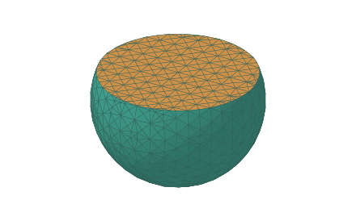

# Keep cuts, seams and periodic pairs distinct

<figure class="guide-figure" id="cut-layers"><fieldset><legend>Show a boundary</legend>
<label><input type="radio" name="boundary" value="" checked> Both</label>
<label><input type="radio" name="boundary" value="wall"> Spherical wall</label>
<label><input type="radio" name="boundary" value="cap"> Planar cut</label>
</fieldset><figcaption>The wall has one active constraint, the cap has another, and the rim has both.</figcaption></figure>

| Pick a location | Keep it on |
| --- | --- |
| Teal face | Sphere |
| Copper face | Plane |
| Rim | Sphere **and** plane |

1. Switch the viewer to **Planar cut** and locate the rim.
2. Switch to **Spherical wall**. The rim belongs to both surfaces.

## Put a moved node back on its feature

| Active planes | Project (0.7, 0.7, 0.2) onto them |
| --- | --- |
| x = 0.5 | (0.5, **0.7**, 0.2) |
| x = 0.5 and y = 0.5 | (0.5, **0.5**, 0.2) |

1. Read active fields from the constraint mask.
2. Linearize them at the proposed point. Solve their planes together with locked coordinates fixed.
3. Repeat for curved walls. For affine planes the first projection is exact.

[Joint Newton step](https://github.com/kmarchais/meshers/blob/fc54032b/crates/meshers-core/src/projection.rs#L6) · [Affine plane solver](https://github.com/kmarchais/meshers/blob/fc54032b/crates/meshers-core/src/polyhedral.rs#L111)

**Mapped seed:** the inverse map takes a physical point back to the chart for field evaluation. [Seed requirements](intersections.md#adapt-in-physical-coordinates)

## Opposite faces

<figure class="guide-figure"><figcaption>A translated pair has two node IDs. Its tangential coordinates and the triangulation on the two caps must match.</figcaption></figure>

1. Identify opposite copies for adaptation.
2. Measure edges to their nearest periodic image.
3. Unfold the cell and inspect matching cap triangles.

| End condition | Solver receives |
| --- | --- |
| Translated box | Node pairs and a translation |
| Curved sector | Pairs and a rigid transform. Rotate vector DOFs. |
| Welded full turn | An interior seam with no external pairs on that axis |

[Map the background before cutting](https://github.com/kmarchais/meshers/blob/fc54032b/crates/meshers-core/src/implicit/intersection.rs) · [Exported metadata](intersections.md#map-and-pair-the-ends)

**Next:** [Fit curved elements](course-quadratic.md).

