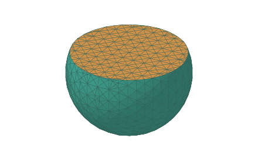

# Runnable Python examples

<div class="mesh-gallery" markdown="1">

[ **Vary the band width**](fields.md)

[ **Inspect a named face**](intersections.md)

[ **Explore periodic pairs**](quality.md#pair-opposite-faces)

</div>

From the **repository root**, install the [development environment](contributing.md) and run:

```sh
uv run --extra io --package meshers crates/meshers-python/examples/basic.py
```

| Goal | Script |
| --- | --- |
| Mesh a TPMS, inspect arrays, export volume and surface | [basic.py](https://github.com/kmarchais/meshers/blob/main/crates/meshers-python/examples/basic.py) |
| Vary sheet thickness in space | [graded.py](https://github.com/kmarchais/meshers/blob/main/crates/meshers-python/examples/graded.py) |
| Compare compiled fields, gradients and callbacks | [evaluators.py](https://github.com/kmarchais/meshers/blob/main/crates/meshers-python/examples/evaluators.py) |
| Pair opposite faces and set a quality floor | [periodic.py](https://github.com/kmarchais/meshers/blob/main/crates/meshers-python/examples/periodic.py) |
| Label cut faces and find their common edges | [intersection.py](https://github.com/kmarchais/meshers/blob/main/crates/meshers-python/examples/intersection.py) |
| Mesh a cylindrical or toroidal gyroid | [curved_tpms.py](https://github.com/kmarchais/meshers/blob/main/crates/meshers-python/examples/curved_tpms.py) |
| Cancel a job or handle invalid input | [cancellation.py](https://github.com/kmarchais/meshers/blob/main/crates/meshers-python/examples/cancellation.py) |
