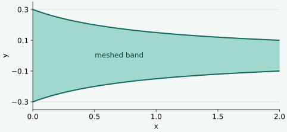

# Fields, thickness and grading

Meshers keeps `f ≤ 0` for a solid or `lower ≤ f ≤ upper` for a band. Band limits use **field units**. Where the field changes faster, the same interval can produce a thinner wall.

In this section through the field <i>f</i> = (1 + <i>x</i>)<i>y</i>, a band of ±0.3 has vertical width 0.6 on the left and 0.2 on the right.

For spatial grading, divide the field by a **positive** half-width and mesh the interval `(-1, 1)`. Grading along a periodic axis must match at its ends. [Runnable graded sheet](https://github.com/kmarchais/meshers/blob/main/crates/meshers-python/examples/graded.py)

| Field implementation | Evaluation and derivatives |
| --- | --- |
| Arithmetic, supported NumPy functions, comparisons, `np.where` | Meshers traces and compiles the expression and its gradient, including derivatives of grading terms. |
| Unsupported operation or `compile=False` | Batched NumPy callback returning float64 `(N,)`. Supply gradients of shape `(N, 3)` or use finite differences. |
| `compile_field(f)` | Reusable, immutable snapshot. Automatic preparation retraces captured values and caches up to 32 compiled expressions. |

At `abs(0)` the derivative is zero. At a minimum or maximum tie, Meshers averages the two gradients. `where` takes the selected branch. For swept or angular coordinates, define a consistent inside/outside value at the axis and across the seam. [Evaluator examples](https://github.com/kmarchais/meshers/blob/main/crates/meshers-python/examples/evaluators.py)
