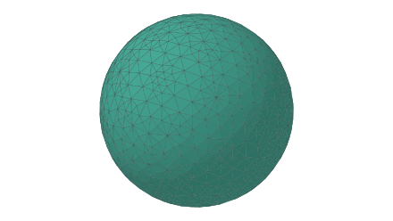

# Install and mesh a sphere

```sh
python -m pip install "meshers[io]"
```

For meshing without file export, install `meshers`. It requires NumPy.

| Source | Python | VTKHDF writer installed by `[io]` |
| --- | --- | --- |
| [PyPI 0.2.1](https://pypi.org/project/meshers/0.2.1/) | 3.10+ | h5py |
| [Development checkout](contributing.md) | 3.11+ | VTK |

These docs follow the development checkout.

<div class="guide-pair" markdown="block">

<figure class="guide-figure"><figcaption>The exported surface contains the outer triangles of the tetrahedral volume.</figcaption></figure>

<div markdown="block">

```python
import meshers


def sphere(x, y, z):
    return x * x + y * y + z * z - 0.7**2


mesh = meshers.generate(
    sphere,
    bounds=(-0.8, 0.8) * 3,
    cells=12,
    geometry_tolerance=0.04,
    optimize_passes=2,
)
mesh.write_vtkhdf("sphere.vtkhdf")
mesh.write_vtkhdf("boundary.vtkhdf", surface=True)
```

</div>
</div>

- **Domain** — three low/high coordinate pairs. The mesher keeps the negative side inside this box.
- **Resolution** — `cells=12` gives 12 background intervals per axis. The final tetrahedron count depends on the cuts.
- **Output** — `points` holds coordinates, `tetrahedra` indexes volume cells and `surface` indexes boundary triangles. Tolerance uses the same length units as the coordinates.

[Try the examples](examples.md) · [Inspect quality and boundary tags](quality.md)
