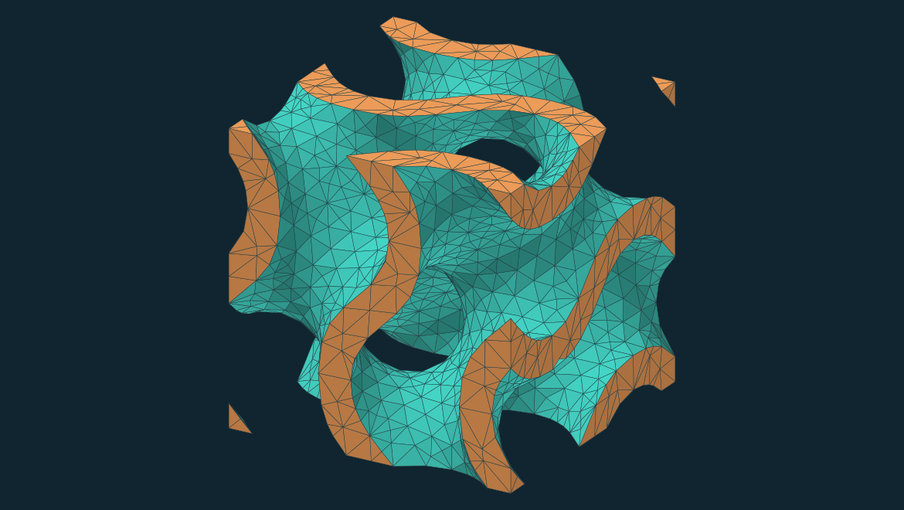

# Tetrahedral meshes from implicit solids



This gyroid is cut from a 12 × 12 × 12 background grid. Teal triangles follow the implicit walls. Copper triangles mark the box faces. Use the tetrahedra for analysis and the tagged surface triangles for boundary conditions.

```python
import meshers

mesh = meshers.generate("gyroid", band=(-0.5, 0.5), cells=12, periodic=(True, True, True))
```

- [Generate and export your first mesh](getting-started.md)
- [Keep a cut face or pair periodic boundaries](intersections.md)
- [Check the mesh](quality.md) and [see how displacement error changes with refinement](solver-verification.md)
