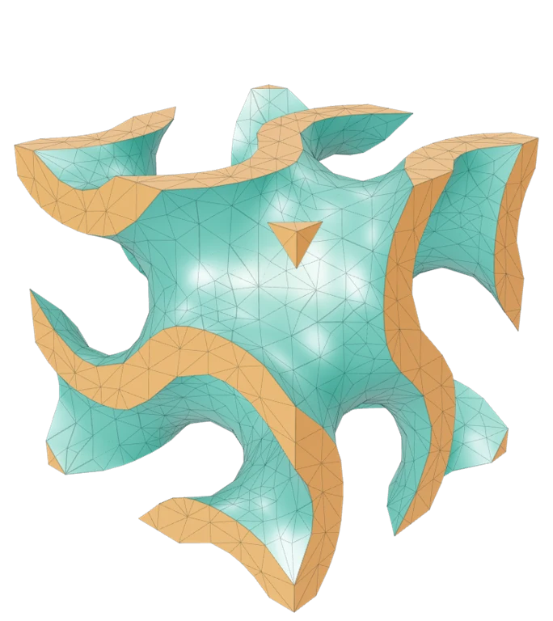
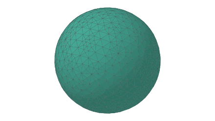

# Tetrahedral mesh explorer

Meshers turns implicit solids into tetrahedral meshes for finite element analysis. Try a periodic sheet below. Drag to orbit, scroll to zoom.

  

    
    <canvas tabindex="0" aria-label="3D mesh. Drag or use arrow keys to rotate. Use plus and minus to zoom." hidden></canvas>
    
Implicit wallBox cap

  

  <form class="mesh-controls">
    <h2>Mesh settings</h2>
    <fieldset class="mesh-fields">
      <legend>Implicit field</legend>
      

        <label><input type="radio" name="field" value="0" checked>Gyroid</label>
        <label><input type="radio" name="field" value="1">Schwarz P</label>
      

    </fieldset>
    

      <label for="mesh-cells">Cells per axis</label><output for="mesh-cells">10</output>
      <input id="mesh-cells" type="range" min="6" max="16" value="10">
    

    

      <label for="mesh-width">Band half-width</label><output for="mesh-width">0.50</output>
      <input id="mesh-width" type="range" min="0.30" max="0.80" step="0.05" value="0.50">
    

    

      <label class="mesh-switch"><input id="mesh-lines" type="checkbox" checked>Triangle edges</label>
      <button type="button" id="mesh-reset" disabled>Reset view</button>
    

  </form>
  
Preparing the 3D view…

<noscript>Enable JavaScript to rotate and regenerate the mesh.</noscript>

<pre><code id="mesh-code">import meshers as mrs

mesh = mrs.generate(
    "gyroid", cells=10, band=(-0.5, 0.5),
    periodic=(True,) * 3, geometry_tolerance=0.05,
    optimize_passes=2, threads=0,
)</code></pre>

## Project scope

Meshers starts from a scalar field sampled in a bounding box. Choose a solid (`f ≤ 0`), a band between two levels, or the intersection of named fields. Custom fields are welcome; coverage is established for specific geometries, resolutions and tolerances. [Seven tested implicit solids](benchmark-index.md#geometry-and-solver-studies)

| Status | What you can mesh |
| --- | --- |
| Volume meshing today | Tet4 and curved Tet10 for implicit solids, including periodic and graded fields. Named intersections retain boundary labels. A supplied Tet4 seed can also be adapted with matching fields and constraint masks. [Fields](fields.md) · [Seed requirements](intersections.md#adapt-in-physical-coordinates) |
| Adaptation today | Refine and coarsen tetrahedra to local size and boundary-curvature targets. Thin walls, gaps and enclosed cavities can fall between field samples. A returned mesh can miss a feature. [Adaptation](course-adaptation.md) · [Lost-cavity replay](benchmark-gaps.md#reproduce-the-lost-cavity) |
| Experimental surfaces | Extract triangles directly in a surface-enabled build. Uniform quad extraction is a Rust research feature. [Surface methods](course-surfaces.md) |

See the [roadmap](roadmap.md) for open FRep targets, planned FEA capabilities and longer-term CAD and element support.

## Explore the guides

[ **Generate your first mesh**](getting-started.md)

[ **Label an intersection**](intersections.md)

[ **Verify a finite element solution**](solver-verification.md)

[ **Inspect boundary quality**](quality.md)

Explore the [meshing algorithms](course-fields.md) from field samples to a verified finite element solution. For the code behind this explorer, see the [WebAssembly reference](api/wasm.md).

