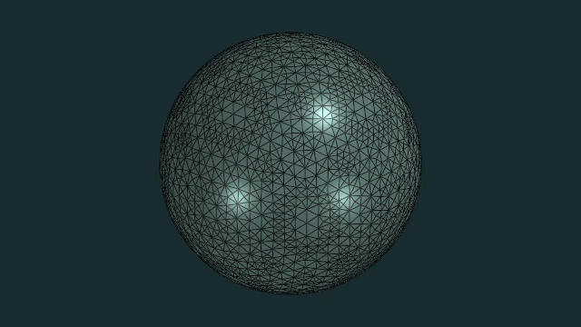
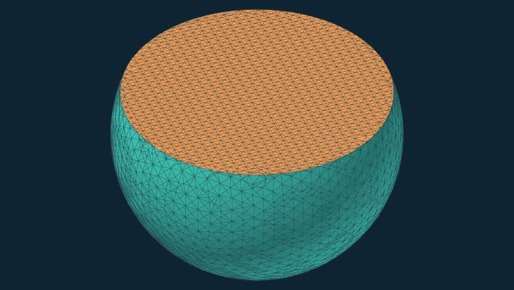
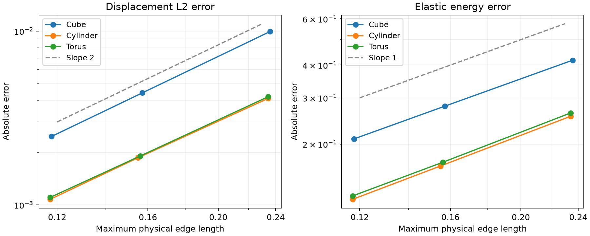

---
hide:
  - toc
---

# Tetrahedral mesh explorer

Generate a periodic solid and inspect its tetrahedral mesh. Drag to orbit, scroll to zoom.

  

    
    <canvas tabindex="0" aria-label="3D mesh. Drag or use arrow keys to rotate. Use plus and minus to zoom." hidden></canvas>
    
Implicit wallBox cap

  

  <fieldset class="mesh-controls" disabled>
    <legend>Mesh settings</legend>
    <label>Implicit field<select id="mesh-field"><option value="0">Gyroid</option><option value="1">Schwarz P</option></select></label>
    <label for="mesh-cells">Cells per axis <output for="mesh-cells">10</output><input id="mesh-cells" type="range" min="6" max="16" value="10"></label>
    <label for="mesh-width">Band half-width <output for="mesh-width">0.50</output><input id="mesh-width" type="range" min="0.30" max="0.80" step="0.05" value="0.50"></label>
    <label class="mesh-lines"><input id="mesh-lines" type="checkbox" checked> Triangle edges</label>
    <button type="button" id="mesh-reset">Reset view</button>
  </fieldset>
  
Loading the mesh explorer…

<noscript>Enable JavaScript to rotate and regenerate the mesh.</noscript>

<pre><code id="mesh-code" class="language-python">import meshers as mrs

mesh = mrs.generate("gyroid", cells=10, band=(-0.5, 0.5),
                    periodic=(True,) * 3, geometry_tolerance=0.05, optimize_passes=0)</code></pre>

## Explore the guides

[ **Generate your first mesh**](getting-started.md)

[ **Label an intersection**](intersections.md)

[ **Verify a finite element solution**](solver-verification.md)

[ **Inspect boundary quality**](quality.md)

