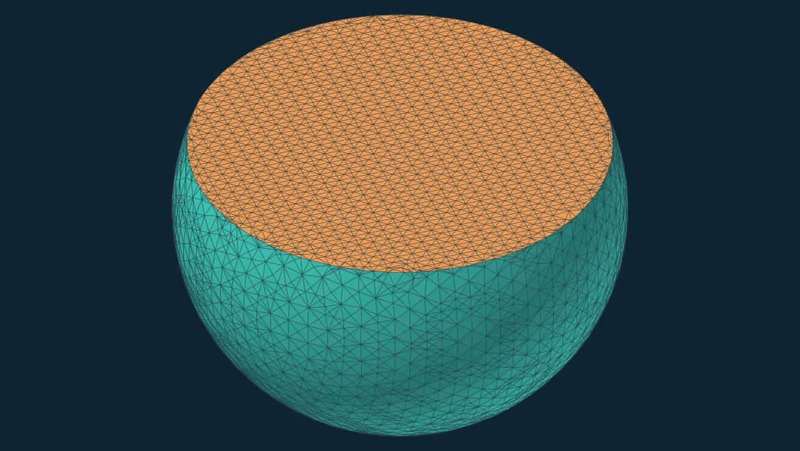

# Named surfaces and curved domains



Intersect the negative sides of named fields to keep a boundary label on each face. For this sphere, the copper plane closes the top at `z = 0.25`.

```python
import meshers

mesh = meshers.generate_intersection(
    {"sphere": lambda x, y, z: x * x + y * y + z * z - 0.7**2, "cut": lambda x, y, z: z - 0.25},
    bounds=(-0.8, 0.8, -0.8, 0.8, -0.8, 0.8),
    cells=24,
    optimize_passes=8,
    geometry_tolerance=0.02,
)
cut_triangles = mesh.surface_for("cut")
rim_edges = mesh.feature_edges
```

`constraint_masks` records each vertex’s membership in the named fields. VTKHDF preserves these masks, names, feature edges, parameter coordinates and periodic metadata.

## Map and pair the ends

| Geometry | What to supply | What the solver receives |
| --- | --- | --- |
| Straight periodic cell | `periodic` on matching axes | Low/high node pairs and box translations |
| Curved sector | An orientation-preserving, one-to-one `coordinate_map` and a rigid 4×4 low-to-high transform per periodic axis | Physical points, chart coordinates and transforms. Use the 3×3 rotation block for vector degrees of freedom. |
| Full turn | `closed_axes` on the periodic seam and the identity transform | Matching end triangles weld into an interior seam. The welded axis has no external pairs. |

The map acts on the background **before cutting**. Fields, bounds and cell counts use chart coordinates. [Cylinder and torus example](https://github.com/kmarchais/meshers/blob/main/crates/meshers-python/examples/curved_tpms.py)

## Adapt in physical coordinates

- For a mapped seed, pass `adapt=True`, `inverse_map` and `physical_bounds`. The seed must resolve the features, have positive orientation and pass `seed_tolerance` (default 0.01).
- For an existing conforming Tet4 seed, use `adapt_intersection` with physical fields and matching constraint masks. Physical adaptation supports one worker and nonperiodic solids. Returned `parameters` are physical coordinates.
- Final acceptance uses `minimum_quality` and `geometry_tolerance`. On mapped intersections the surface check samples named walls and physical chart caps, including triangle interiors. `mapped_cap_errors` reports each surviving cap. Between-sample deviation and global self-intersection require separate checks.

[Python options and limits](api/python.md) · [Quality checks](quality.md)
