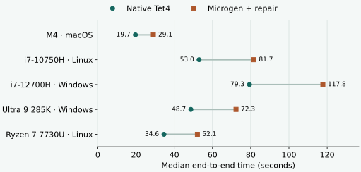

# Performance and regression checks

**What costs less at the same FEA accuracy?** The [Schwarz P comparison](https://github.com/kmarchais/meshers/blob/main/demos/solver/release-wheel/schwarz-matched-cost-20261118/README.md) measures two Tet4 routes that each meet a 1% stiffness-discrepancy target. The [benchmark history](benchmark-history.md) answers a different question: how a code change affects fixed meshing fixtures.



Each point is the median of three complete runs for that setting. The native mesh reached 0.992% discrepancy and the repaired mesh 0.927–0.928%. Each row compares routes on the same hardware.

## Pull request gates

Base and candidate wheels run on one Linux runner with matching Python and NumPy. After a discarded warm-up pair, five fresh-process pairs alternate order. Timing covers field preparation and meshing. Peak process memory includes imports and JIT.

| Metric | Regression limit against base |
| --- | --- |
| Median time | +25% plus 20 ms |
| Median peak memory | +15% plus 8 MiB |
| MMG quality (min, max, mean, median, p05, p10, p90) | 1% decrease for each statistic. Each candidate repeat is also checked against the base median. |
| Sampled wall error and mapped cap error | +5% plus 10⁻¹⁰ for each |
| Volume | ±0.5% |
| Nodes and tetrahedra | ±1% each |

- **Seven cases** — compiled and callback gyroids, graded sheet, mapped intersection, Schwarz P, Fourier spinodoid and ordered lattice. The fixtures use 24 cells and two optimization passes.
- **Absolute gates** — finite coordinates, positive volumes, closed boundary edge incidence, matching requested periodic faces, minimum quality ≥ 0.01 and sampled error ≤ 0.1. Cap each sample at 250,000 nodes and 250,000 tetrahedra.
- **Geometry comparisons** — fixture version 4 measures walls and mapped caps separately on both wheels. The [implicit coverage study](https://github.com/kmarchais/meshers/blob/main/demos/solver/implicit-coverage/README.md) also records admitted and rejected geometries.

## Release suite and public history

The release suite adds adaptive gyroid, spinodoid, lattice and curved Tet10 fixtures. Tet10 quality and surface errors describe the parent. The current validator integrates curved volume, samples Jacobians and subdivides inconclusive Bernstein determinant bounds. Unresolved bounds fail.

1. Run **Performance** on the candidate with `suite=release`, a compatible release `baseline` and a unique `history_label`. For the first 0.2 suite the compatible reference was `afc49e583a0450454b02440557f39b89bbc39ca6`.
2. Inspect the `performance-comparison` artifact, including failed or missing samples. Keep the same fixtures and thresholds when investigating a regression.
3. Archive the JSON under the candidate label. Repeat on the immutable final tag and retain both records.

```sh
python -m tools.benchmark_history --input /path/performance.json --label v0.2.0-rc.1
```

## Run a local comparison

Install the two wheels in separate environments. Use one numerical thread and an idle host. For Windows, install `psutil` in each environment. All platforms record bytes: peak working set on Windows, peak RSS on Linux and macOS.

```sh
python tools/performance_gate.py --base-python /path/base/bin/python \
  --head-python /path/head/bin/python --output performance.json
```

Add `--suite release` for all fixtures and `--base-ref` / `--head-ref` with full commit IDs for archiving. Compare times within one configuration and fixture version. Change the fixture version when changing formulas or settings.

## Candidate wheel FEA gate

The Python 3.11 CI jobs reopen a Schwarz P VTKHDF export. Admission requires two-sided sampled wall/cap distance ≤ 0.002, volume within 1%, MMG quality ≥ 0.1, correct topology, periodic faces and material probes. Six strain and six stress solves must pass. Worst relative strain-energy discrepancy must be ≤ 1% against the reference tensor.

```sh
uv run --with fedoo==1.0.0b2 python demos/solver/schwarz_workflow.py native-candidate candidate-acceptance
```
