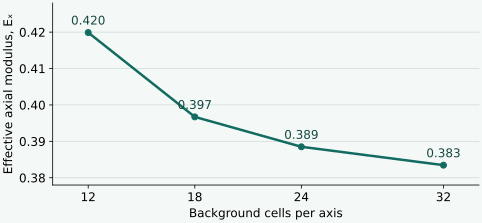

# Effective stiffness of a periodic gyroid



At 32 cells per axis the gyroid has **35.67% solid volume** and **15.34% of the solid material’s axial modulus**. The full stiffness tensor changes by 0.86% from the previous refinement. That measures stability between two meshes. The continuum error is unknown.

## Unit cell and loading

- **Geometry** — period-one gyroid, band `(-0.55, 0.55)`, matching opposite faces and traction-free internal walls. One node anchors translations.
- **Material** — isotropic Tet4 elasticity, E = 2.5 and ν = 0.25. Stresses are averaged over the full cell, including void.
- **Loads** — six prescribed engineering strains and six stress-controlled solves per mesh. Voigt order is xx, yy, zz, xy, xz, yz.

## Checks and replay

All 60 solves converged across four refinements and a solid cube. The cube recovered the input material constants. Checks cover paired displacements, nodal force balance, Hill–Mandel energy consistency, symmetry and positive stiffness. The two loading paths agreed within 4 × 10⁻¹² relative. This study uses translational periodicity.

```sh
uv run --with fedoo==1.0.0b2 python demos/solver/fedoo_homogenization.py
```

[Full tensors, mesh sizes and solve records](https://github.com/kmarchais/meshers/blob/main/docs/fedoo-homogenization-results.json) · [Study implementation](https://github.com/kmarchais/meshers/blob/main/demos/solver/fedoo_homogenization.py)
