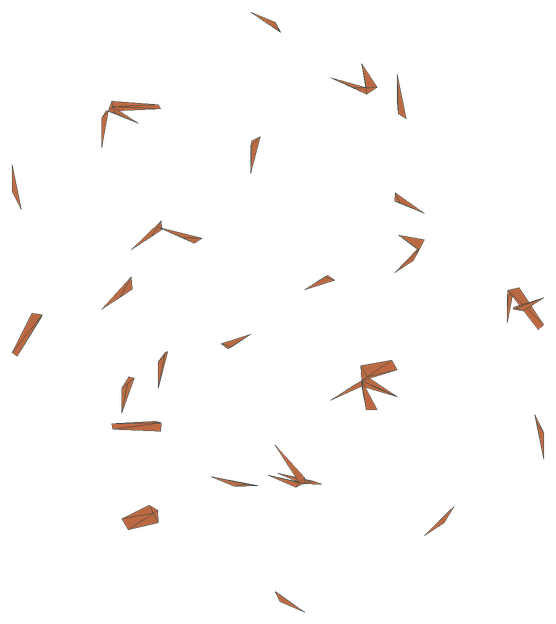

# Check the mesh before a solve

<div class="guide-pair" markdown="block">

<figure class="guide-figure" id="quality-section">
  
  <canvas width="1248" height="1248" hidden aria-label="Filtered gyroid tetrahedra" role="img"></canvas>
  <fieldset class="mesh-slider shape-range" hidden>
  <legend>Shape quality range</legend>
  <div class="range-values"><label for="shape-min">Minimum <output for="shape-min">0.00</output></label><label for="shape-max">Maximum <output for="shape-max">0.10</output></label></div>
  <div class="range-track">
  <input id="shape-min" type="range" min="0" max="1" step="0.01" value="0">
  <input id="shape-max" type="range" min="0" max="1" step="0.01" value="0.10">
  </div>
  </fieldset>
  <figcaption><span role="status">46 of 3,367 cells in range.</span> Shape quality · 0 <span class="quality-scale"></span> 1.</figcaption>
</figure>

<div markdown="block">

**Tetrahedron shape quality** measures the cell’s volume as a fraction of the volume of a regular tetrahedron with the same root-mean-square edge length. A regular cell scores 1. A sliver approaches 0 even if all six edges are long. Uniform scaling leaves the score unchanged.

For volume *V* and root-mean-square edge length *L*, the normalized volume ratio is **6√2 |V| / L³**. Check signed volume separately for orientation. [MMG’s isotropic tetrahedron measure](https://github.com/MmgTools/mmg/blob/v5.8.0/src/mmg3d/inlined_functions_3d_private.h#L287-L354)

Generate this specimen with Meshers 0.2.1.

```python
import meshers as mrs

mesh = mrs.generate(
    "gyroid",
    cells=8,
    band=(-0.5, 0.5),
    periodic=(True,) * 3,
    geometry_tolerance=0.05,
    optimize_passes=0,
)
```

</div>
</div>

## Flatten a tetrahedron

<figure class="guide-figure" data-guide="quality">
  <div class="guide-diagram"></div>
  <div class="guide-control mesh-slider"><label for="quality-setting">Apex height</label><output for="quality-setting"></output><input id="quality-setting" type="range" min="1" max="100" value="5"></div>
  <figcaption>Shape quality · 0 <span class="quality-scale"></span> 1. Flattening the second cell preserves its base and reduces its volume.</figcaption>
</figure>

## Pair opposite faces

<figure class="guide-figure">
  
  <figcaption>Each dashed line connects two nodes with the same y and z coordinates, one box length apart in x.</figcaption>
</figure>

<script type="module" src="assets/guide-controls.js"></script>

| Inspect | What to check |
| --- | --- |
| Orientation | Positive signed Tet4 volumes. For Tet10, exported `Volume` integrates the curved mapping. |
| Shape | `minimum_quality` rejects a nonempty mesh below your floor. Tet10 `CornerMMGQuality` describes its linear parent. |
| Boundaries | Tag 0 marks implicit faces. Tags 1/2, 3/4 and 5/6 mark low/high x, y and z caps. `sampled_surface_error` describes the linear parent. Curved faces need their own distance audit. |
| Periodicity | Request matching axes explicitly. Check `periodic_pairs` against the intended translation or [rigid transform](intersections.md). Transform the shift vectors if you transform the mesh. |
| Solver accuracy | Refine the mesh and measure the change in the physical quantity you need. [Elasticity example](solver-verification.md) |

## Missing material

Set `expected_components` on the development branch to catch a lost island or severed ligament, even when every surviving element has positive volume.

- Meshers counts groups connected across triangular faces **before** joining periodic images. Vertex or edge contact does not join groups.
- Two defects can preserve the count. Use per-component volume and probes in thin features to check identity.
- A sampled-empty Tet10 result has connectivity shapes `(0, 10)` and `(0, 6)`. Require a positive component count when empty output would be an error.

## Topology and curved orientation

Meshers checks boundary edge incidence and vertex links, and retries cuts if snapping pinches the boundary. Periodic copies roll back together.

During Tet10 elevation and fitting, the development branch bisects regions where determinant bounds cannot rule out a fold. A fold or unresolved bound reduces the correction or rejects the fit. `minimum_jacobian_ratio` reports only sampled points.

Invalid options raise `ValueError`. A failed meshing gate raises `MeshingError`. [Python API](api/python.md)
