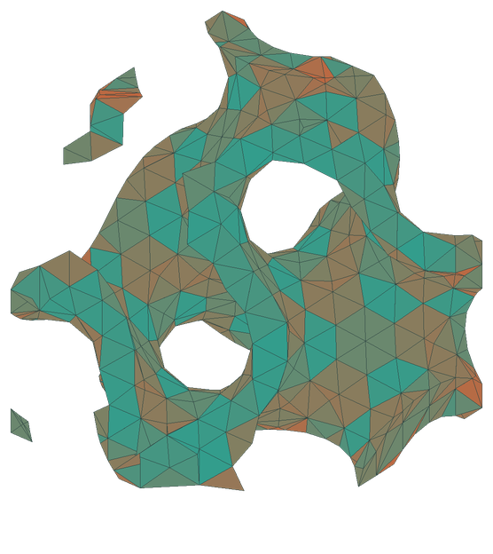

# Check the mesh before a solve

<figure class="guide-figure" id="quality-section">
  
  <fieldset><legend>Gyroid mesh</legend>
    <label><input type="radio" name="quality-view" value="section" checked> Cutaway</label>
    <label><input type="radio" name="quality-view" value="poor"> Isolate cells below 0.1</label>
  </fieldset>
  <figcaption>MMG quality · 0 <span class="quality-scale"></span> 1. Of 3,367 Tet4 cells, 46 score below 0.1. The lowest score is 0.041.</figcaption>
</figure>

Both views color each Tet4 by its own MMG score. To reproduce the specimen with Meshers 0.2.1:

```python
import meshers as mrs

mesh = mrs.generate(
    "gyroid", cells=8, band=(-0.5, 0.5), periodic=(True,) * 3,
    geometry_tolerance=0.05, optimize_passes=0,
)
```

## Flatten a tetrahedron

<figure class="guide-figure" data-guide="quality">
  <div class="guide-diagram"></div>
  <div class="guide-control"><label for="quality-setting">Apex height</label><input id="quality-setting" type="range" min="1" max="100" value="5"><output for="quality-setting"></output></div>
  <figcaption>MMG quality · 0 <span class="quality-scale"></span> 1. Flattening the second cell preserves its base and reduces its volume.</figcaption>
</figure>

## Pair opposite faces

<figure class="guide-figure" data-guide="pairs">
  <div class="guide-diagram"></div>
  <div class="guide-control"><label for="pairs-setting">Highlight a pair</label><input id="pairs-setting" type="range" min="1" max="3" value="1"><output for="pairs-setting"></output></div>
  <figcaption>Opposite faces have matching in-plane coordinates. Each highlighted pair differs by one box length along x.</figcaption>
</figure>

<script type="module" src="assets/guide-controls.js"></script>

| Inspect | What to check |
| --- | --- |
| Orientation | Positive signed Tet4 volumes. For Tet10, exported `Volume` integrates the curved mapping. |
| Shape | MMG quality ranges from 0 (degenerate) to 1 (regular). `minimum_quality` rejects a nonempty mesh below your floor. Tet10 `CornerMMGQuality` describes its linear parent. |
| Boundaries | Tag 0 marks implicit faces. Tags 1/2, 3/4 and 5/6 mark low/high x, y and z caps. `sampled_surface_error` describes the linear parent. Curved faces need their own distance audit. |
| Periodicity | Request matching axes explicitly. Check `periodic_pairs` against the intended translation or [rigid transform](intersections.md). Transform the shift vectors if you transform the mesh. |
| Solver accuracy | Refine the mesh and measure the change in the physical quantity you need. [Elasticity example](solver-verification.md) |

## Missing material

Set `expected_components` on the development branch to catch a lost island or severed ligament, even when every surviving element has positive volume.

- Meshers counts groups connected across triangular faces **before** joining periodic images. Vertex or edge contact does not join groups.
- Two defects can preserve the count. Use per-component volume and probes in thin features to check identity.
- A sampled-empty Tet10 result has connectivity shapes `(0, 10)` and `(0, 6)`. Require a positive component count when empty output would be an error.

## Topology and curved orientation

Meshers checks boundary edge incidence and vertex links, and retries cuts if snapping pinches the boundary. Periodic copies roll back together.

During Tet10 elevation and fitting, the development branch bisects regions where determinant bounds cannot rule out a fold. A fold or unresolved bound reduces the correction or rejects the fit. `minimum_jacobian_ratio` reports only sampled points.

Invalid options raise `ValueError`. A failed meshing gate raises `MeshingError`. [Python API](api/python.md)
