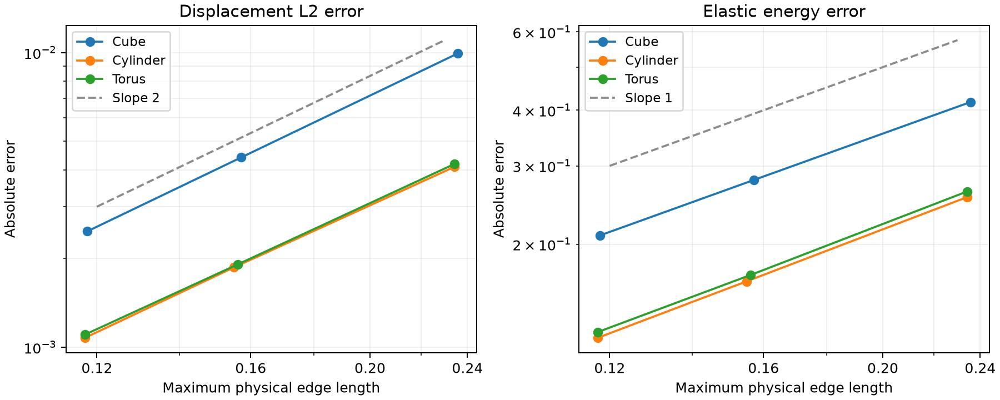

# Does the displacement converge?



| Specimen | Cells per axis | Final displacement order | Final energy order |
| --- | --- | ---: | ---: |
| Cube | 6, 9, 12 | 2.01 | 1.00 |
| Cylindrical gyroid | 12, 18, 24 | 1.97 | 1.05 |
| Toroidal gyroid | 12, 18, 24 | 1.92 | 1.03 |

**Problem.** Linear elastic Tet4 elements, λ = μ = 1. The exact displacement is `(sin(πx) sin(πy) sin(πz), 0, 0)`. The Navier equation supplies the body force. Every boundary node takes the exact displacement. Four-point quadrature integrates the load and errors.

**Cross-check.** Fedoo 0.8.4 and a separate P1 assembly agreed within 5 × 10⁻¹³ relative on the nine meshes. Both used diagonally preconditioned SciPy CG. Affine patch tests passed on all three geometries.

**Scope.** The rates use measured maximum edge length and errors on each discrete domain. For periodic constraints and effective stiffness, see the [unit-cell study](periodic-homogenization.md).

## Replay

```sh
uv run --with scipy python demos/solver/convergence.py
uv run --with fedoo==0.8.4 python demos/solver/fedoo_convergence.py
```

[Independent assembly results](https://github.com/kmarchais/meshers/blob/main/docs/solver-convergence-results.json) · [Fedoo results and environment](https://github.com/kmarchais/meshers/blob/main/docs/fedoo-convergence-results.json)
